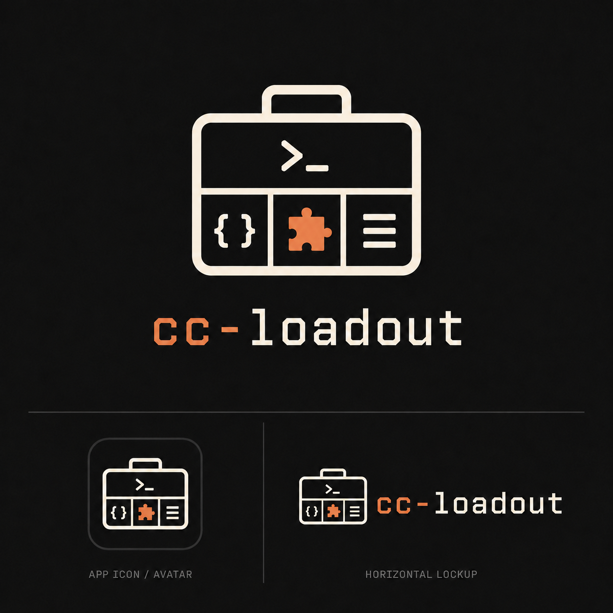

# cc-loadout

<p align="center">
  <a href="https://cc-loadout.pages.dev/">
    
  </a>
</p>

> Claude Code loadout manager — switch between Claude accounts, and build + apply the right plugin profile for each repo.

[](https://github.com/xbluesky/cc-loadout/actions/workflows/ci.yml)
[](LICENSE)
[](CODE_OF_CONDUCT.md)

**English** | [繁體中文](README.zh-TW.md)


`cc-loadout` is a small Rust CLI that manages two parts of your Claude Code setup:

- **Accounts** — snapshot the credentials of each Claude Max / subscription account and switch between them with one command (e.g. when one account hits its session limit).
- **Profiles** — decide which plugins each repo needs, and keep that in sync. An interactive **board** (`cc-loadout profile init`, or just run `cc-loadout` and tab to Profile) scans your installed plugins and repos so you can sort them into profiles, and writes your `profiles.json`. (Prefer to have Claude propose the grouping? Use the bundled `/cc-loadout:init` skill — it validates and backs up before writing.) Open any profile to edit its **detection rules** (which repos it applies to) right in the board, with a live count of matching repos and near-miss hints as you type. It then turns the profile-specific plugins **off globally** (keeping the universal ones on), so by default a repo loads only the universal set; `apply` re-enables each repo's matching plugins in its `.claude/settings.local.json`. The result: the right plugins per repo, instead of loading all of them everywhere.

## Quickstart

```bash
# 1. Install (from a clone; needs a Rust toolchain)
git clone https://github.com/xbluesky/cc-loadout && cd cc-loadout && ./install.sh

# 2. Snapshot the account you're logged into — then your others
cc-loadout account add work
#    /login to another account in Claude Code, then:
cc-loadout account add personal

# 3. Switch in seconds when one account hits its 5-hour limit
cc-loadout account use personal --launch

# 4. Set up per-repo plugin profiles — open the hub:
cc-loadout
#    → Tab to Profile, sort the Unassigned plugins into profiles, then
#      press w to apply. Each repo now loads only the plugins that fit it.
#      (Or run /cc-loadout:init in Claude Code and set it up by chatting.)
```

New here? The Profile tab is a **board**: every plugin sits under **Universal**
(loaded everywhere), a **profile** (loaded in matching repos), or **Unassigned**.
Setup = empty the Unassigned bucket, then `w` to apply.

## Why

- **Session limits.** With more than one Claude subscription, hitting a limit on one account shouldn't stop your work — `cc-loadout account use <other>` swaps the active login in seconds.
- **Plugin budget.** Claude Code loads every enabled plugin's skills into every session, overflowing the skill-description budget and mis-firing skills across repo types. `cc-loadout` disables the profile-specific plugins globally and re-enables each only in the repos that match its profile, so a session loads just the universal plugins plus the few that fit the current repo.

## Features

- Single binary, no runtime dependencies.
- `account` — snapshot / switch / list real Claude logins; transactional, atomic credential swaps with rollback and post-switch verification.
- `profile inventory` — list your installed plugins and per-repo signals (also `--json`, to feed the wizard and the agent skill).
- `profile init` / `edit` — an interactive **board** (also reachable by running `cc-loadout` and tabbing to Profile) that builds `profiles.json` by sorting installed plugins into profiles, with a re-edit view that flags drift (new/uninstalled plugins, uncovered repos, global drift). Atomic write; backs up any existing file; adjusts the global enabled set so non-universal plugins stop loading everywhere. `profile init --root <dir> --assign <file>` runs the same setup non-interactively for agents / CI.
- **Edit detection rules in the board** — open a profile's Detail view → Rules tab to author what it matches, no JSON by hand: four rule kinds (`path under` / `has file` / `has any` / `contains`), a live match-count and **near-miss** panel as you type, `?` to explain why any scanned repo matches (or doesn't), `f` to seed rules from an example repo, and ghost path-completion for `path under` values.
- `profile detect` / `apply` — per-repo plugin detection (path prefix, marker files, marker globs, and file-content matches — a named file containing a word; legacy `package.json`-deps / dependency-keyword rules are still honoured for older configs) with manual override; additive universal + profile plugin sets; a surgical merge that preserves your on-demand and unrelated settings. `--all` sweeps every git repo under your scan roots.
- `doctor` / `doctor --fix` — inspect and repair cc-loadout's own installation: seeds a missing `profiles.json`, promotes managed plugins (including cc-loadout itself) back to `scope: user` when they've drifted to `scope: local`, clears retired `settings.json` hook entries from older versions, and reports (`--prune-backups` to delete) the timestamped backup files earlier versions left behind. It also reports (`--prune-records` to delete) redundant `scope: local` plugin records: Claude Code writes one installation record per (plugin, repo) whenever a repo's `settings.local.json` enables a plugin, even when a `scope: user` record already resolves it everywhere, so they accumulate one batch per repo you open. Only records for keys cc-loadout manages *and* that already have a `scope: user` twin are removed, so nothing you installed locally on purpose is touched.
- **Collector tasks** — `collector set` and `task add --collector` schedule a run of Geralt's collector launcher instead of `claude -p`: fail-fast lock, per-task wall timeout, a subreaper-backed clean-up of the whole process tree, and one metadata-only execution record per attempt (Linux only; see [Collector tasks (Geralt)](#collector-tasks-geralt)).
- Ships as a Claude Code plugin too: the bundled `/cc-loadout:init` skill creates your profiles by chatting with Claude (no TTY needed). This is the only Claude-assisted path — it routes through `profile init --assign`, which validates the assignment and backs up your existing config before writing.

## Install

### As a Claude Code plugin (recommended)

cc-loadout ships as a Claude Code plugin bundling a guided profile-creation skill.
Add it as a marketplace, then install:

```
/plugin marketplace add https://github.com/xbluesky/cc-loadout
/plugin install cc-loadout@cc-loadout
```

That's it — installing the plugin provisions the CLI itself. At the next
session start, its launcher downloads the pinned release build, verifies its
checksum, and links it at `~/.local/bin/cc-loadout`, so the `cc-loadout`
command and the bundled `/cc-loadout:init` skill run the same build — unless
a pre-existing standalone install already occupies that path (see below), in
which case the command keeps running that build until you converge them.
Make sure `~/.local/bin` is on your `PATH` so the interactive TUI is
reachable by name — the hook has no way to see your shell's `PATH` to warn
you if it isn't.

Then run `/cc-loadout:init` — or just ask Claude to "set up my cc-loadout
profiles". The interactive `cc-loadout profile init` TUI is the no-agent
alternative.

Already installed with `install.sh` before this change? Your binary keeps
working, and the `cc-loadout` command keeps running it instead of the
plugin's build until you converge them. From the next session start on, the
plugin names it — every session, not just once — with a "standalone install"
notice, and hands you the exact `doctor --fix` command that converges the
two onto one plugin-managed binary.

### `install.sh` (the CLI without the plugin)

```bash
curl -sSL https://raw.githubusercontent.com/xbluesky/cc-loadout/master/install.sh | bash
```

For anyone who wants the CLI on its own. It downloads a release, verifies its
checksum, and links it at `~/.local/bin/cc-loadout` — the same
data-dir-plus-symlink layout the plugin's launcher maintains, so the two front
doors share one binary instead of each keeping a separate copy. It then runs
`cc-loadout doctor --fix`, which seeds `~/.claude/profiles/profiles.json`
(only if absent — your edits are safe), promotes managed plugins to
`scope: user`, and clears any hook entries a much older version of `install.sh`
wrote directly into `~/.claude/settings.json` (hooks now ship with the
plugin). It is idempotent — re-run after a new release, or run
`cc-loadout doctor` any time to check for drift. Make sure `~/.local/bin` is
on your `PATH`. (Installing to somewhere else with `INSTALL_DIR=...`? The
plugin's own symlink still lands at `~/.local/bin` unless
`CC_LOADOUT_LINK_DIR` is also set, so both directories may end up holding a
link — into the same managed data dir, but not necessarily the same
version: `install.sh` links the *latest* release, while the plugin's
launcher links the version pinned in `.claude-plugin/cli-version`, so the
two agree only once the pin catches up to latest.)

### From source (requires a Rust toolchain)

```bash
git clone https://github.com/xbluesky/cc-loadout ~/code/cc-loadout
cd ~/code/cc-loadout
./install.sh
```

Run from a clone, `install.sh` builds with `cargo` instead and installs a real
file at `~/.local/bin/cc-loadout` — deliberately *not* the plugin's managed
data dir, since a dev build parked there would be indistinguishable from a
release and every session would silently run uncommitted code. To point the
plugin at this build instead of downloading its own pinned release,
`export CC_LOADOUT_BIN=~/.local/bin/cc-loadout`. (No toolchain found, or the
build fails? It falls back to the downloaded layout above.) Make sure
`~/.local/bin` is on your `PATH`.

## Usage

### Accounts

```bash
cc-loadout account add work                 # snapshot the currently logged-in account as "work"
# /login to your other account in Claude Code, then:
cc-loadout account add personal
cc-loadout account list                     # '*' marks the active account; shows email / org / token status
cc-loadout account use work                 # swap credentials only (restart Claude / `claude --continue` to apply)
cc-loadout account use work --launch        # swap, then relaunch `claude --continue`
cc-loadout account current
cc-loadout account rm personal
cc-loadout account prime personal           # anchor 'personal's 5h window now (--json for machine output)
cc-loadout account schedule                  # interactive wizard (human)
cc-loadout account schedule set personal 06:00 11:00 16:00   # non-interactive (AI): set times
cc-loadout account schedule clear personal   # clear one account's schedule (omit alias = clear all)
cc-loadout account schedule list --json      # schedule + next_fire (RFC3339) + last_primed
cc-loadout account list --json               # machine-readable list (also: current --json, status --json)
```

> **Interactive (no alias).** `cc-loadout account` (or `account use` with no alias) opens a picker to switch accounts; `account prime` / `account rm` with no alias pick interactively too. Pass an explicit `<alias>` for the non-interactive (scriptable / agent) form.

Snapshots live in `~/.local/share/cc-loadout/accounts/<alias>/` (credential files are `0600`). A switch is transactional: it reads the target first, refreshes the outgoing snapshot, writes the new login atomically (rolling back on failure), then verifies the live account actually changed.

**Housekeeping sweep.** The Schedule tab's `s` key (or a `maintenance` block in `tasks.json`) schedules `doctor --fix --prune-records` into the same managed `cron` block. It runs the binary directly — no Claude session, no account, no model spend — and the tab shows how many redundant records a run would reclaim right now. Off by default.

**Window priming.** Claude's 5-hour usage window starts on an account's first request, not on the wall clock. `account prime <alias>` sends a minimal request *as that account* (isolated, without disturbing the active one) so its window opens at a time you choose; `account schedule` writes those times into a managed `cron` block that runs `account prime` for you. Priming the currently active account is a no-op (it would rotate the live session's token out from under it). cron is the only scheduler — there is no daemon.

**JSON output for agents.** Read commands take `--json` (`account list`/`current`, `account schedule list`, `account prime`, and top-level `status`). Output is a single object `{ "schema_version": 1, … }` on stdout with exit 0; errors exit non-zero with a human message on stderr. New keys may be added without bumping `schema_version`, so consumers should ignore unknown keys. `status --json` also includes a `priming` section (per scheduled account: `next_fire`, `last_primed`).

### Profiles

```bash
# inside a git repo:
cc-loadout profile inventory          # list installed plugins + per-repo signals
cc-loadout profile inventory --json   # same, machine-readable (used by the agent flow)
cc-loadout profile inventory --root /path/to/tree   # scan one tree instead of all scan_roots
cc-loadout profile init               # interactive board -> profiles.json (+ adjusts the global plugin set)
cc-loadout profile init --root <dir> --assign <file|-> --json   # non-interactive (agents/CI) — see "Headless setup"
cc-loadout profile edit               # interactively edit an existing profiles.json
cc-loadout profile detect            # which profiles match + the resulting plugin set
cc-loadout profile apply             # write enabledPlugins to .claude/settings.local.json
cc-loadout profile status            # what's currently enabled
cc-loadout profile detect --json     # machine-readable: repos[].{matched,plugins,signals[{profile,rule,value}]}
cc-loadout profile apply  --json     # applies + reports the enabledPlugins diff as JSON
cc-loadout profile status --json     # machine-readable: repos[].applied = enabled plugin keys
cc-loadout profile force frontend    # pin this repo to specific profile(s) via .claude/profile

# across every git repo under scan_roots:
cc-loadout profile detect --all
cc-loadout profile apply  --all
cc-loadout profile apply  --all --dry-run   # audit only: which repos are out of sync (writes nothing)
```

`apply --all` prints only the repos it changed, then a summary line. Add
`--dry-run` to answer "which repos still need applying?" without writing —
useful after cloning new repos into a scan root:

```console
$ cc-loadout profile apply --all --dry-run
--- /src/new-repo ---
Profiles: rust
  rust-analyzer-lsp@claude-plugins-official: (unset) -> true

Summary: 1 of 996 repos would change; 24 match no profile.
```

Pair it with `--json` to script the audit — `repos[].changed` is empty for
every repo that is already in sync:

```bash
cc-loadout profile apply --all --dry-run --json \
  | jq -r '.repos[] | select(.changed|length>0) | .repo'
```

### Editing detection rules in the TUI

`cc-loadout profile edit` (or run `cc-loadout`, tab to **Profile**, press `v` for
the by-profile view, and open a profile) lands on the board. Opening a profile
reaches its **Detail** view; `Tab` to the **Rules** tab to author what the
profile matches — no JSON by hand. Four rule kinds cover every case:

| Rule | Matches a repo when… |
|---|---|
| `path under` | the repo lives under a folder (path prefix) |
| `has file` | a file with that exact name sits at the repo root |
| `has any` | any file matches a glob (`*.vue`, `*.rs`) |
| `contains` | a named file contains a word (e.g. `requirements.txt` → `torch`) |

As you build a rule the board shows a **live count** of matching repos and a
**near-miss** panel — repos that *almost* match, with the one rule that would
catch them. Keys in the Rules tab: `a` add, `e` edit, `d` delete, `f` seed rules
from an example repo, `?` explain why a chosen repo matches (or doesn't). A
`path under` value offers ghost directory-completion — `→` accepts it. Repos that
pin themselves with a `.claude/profile` override are left out of the preview,
since detect rules don't classify them.

Match counts, drift, and the Apply preview are a snapshot as of the last
scan, not a live disk check: `s` walks every scan root and answers every
current rule in one pass. A count showing `…` means a rule touched an atom
the index hasn't seen yet; committing the rule auto-indexes just that atom
in the background, or press `s` to index everything at once. Writes are the
exception — `apply`/`w` always re-detects each repo fresh at write time,
regardless of what the preview showed. A `profiles.json` cache built by an
older version of `cc-loadout` opens with a dim "index outdated — rebuilding
in background…" banner while it upgrades itself automatically.

### Headless setup (agents / CI)

`profile init` opens the interactive TUI by default. Pass `--assign` to run it
non-interactively, with no terminal — this is the path an AI agent or a script
uses. The full setup is three steps:

1. **Inspect.** `cc-loadout profile inventory --root <dir> --json` reports the
   installed plugins (`plugins[].key`) and the profiles it suggests from the
   scan (`suggested_profiles[].name`, each carrying the detect markers it found).

2. **Assign + write.** Map the installed plugins onto `universal` (loaded in
   every repo) and onto the suggested profile names, then write it:

   ```bash
   cat > assignment.json <<'JSON'
   {
     "universal": ["serena@official"],
     "profiles": {
       "rust": ["rust-analyzer@community"],
       "node": ["eslint@community"]
     }
   }
   JSON
   cc-loadout profile init --root <dir> --assign assignment.json --json
   ```

   This writes `profiles.json` (each profile's detect rules come from the scan)
   and adjusts the **global** enabled set (`~/.claude/settings.json`): universal
   plugins stay enabled, every other managed plugin is disabled there, so it no
   longer loads in every repo. Input is validated strictly: an unknown profile
   name, an uninstalled plugin key, an unknown JSON field, or an empty
   assignment aborts before anything is written. `--assign -` reads stdin; the
   `--json` result includes a `next_step` reminder.

3. **Activate per repo.** `cc-loadout profile apply --all` enables each repo's
   matching plugins in its `.claude/settings.local.json`, bringing a
   profile-specific plugin back on only in the repos it matches.

Net effect: every repo loads just the universal plugins by default, and each
profile's plugins appear only in the repos that match it.

### Collector tasks (Geralt)

A **collector task** is a scheduled run that is handed to the collector launcher
of a Geralt checkout instead of starting `claude -p`. cc-loadout stays the
scheduler and the process supervisor, and writes one small *execution record*
per attempt for Geralt's reporter to pick up. It does not talk to Geralt, hold a
Geralt token or read Geralt's configuration, and it never builds a Claude
command line: how Claude is started (flags, MCP config, allowed tools, plugins,
model, max turns, the prompt file) is all in the launcher config. A collector
task has no prompt, cwd, profile or model of its own.

```bash
# once per machine: the Node.js binary, the Geralt checkout, the export directory
cc-loadout collector set --node /usr/bin/node --geralt-repo /srv/geralt \
  --export-dir /var/lib/geralt/runner-export --runner-instance-id runner-a
cc-loadout collector show [--json]     # prints the saved settings (touches nothing)

# per task; every path is absolute, there are no defaults for the last three flags
cc-loadout task add geralt-collect --account work --at 07:00 12:00 --collector \
  --launcher-config /etc/geralt/launcher.toml \
  --wall-timeout-secs 1800 --grace-ms 12000
```

`collector set` replaces the saved settings and touches no crontab. `task add`
installs the cron line the way it does for any task (it rewrites the managed
`cron` block). The task id is also the `taskId` of every record, so it must be
1-200 characters of letters, digits, `_ . : -`, starting with a letter or digit;
`runner-instance-id` follows the same rule and has to match the reporter's
binding. `--wall-timeout-secs` is 1..=86400 and `--grace-ms` is 2500..=600000.

**What a run does.** `cc-loadout task run <id>` (the cron entry point):

1. Tries the cc-loadout lock **without waiting**. If another run holds it, the
   attempt is recorded as `skipped_busy` / `lock_busy` and ends at once; no
   launcher starts. (Plain tasks still block on the lock.)
2. Starts `<node> --import tsx <geralt-repo>/src/launcher/main.ts run --config
   <launcher-config> --attempt-ref <attempt-id> --session-id <uuid>` with the
   Geralt checkout as its cwd, stdin closed and its own process group. The
   prompt is never on the command line. The environment is yours, except that
   `CORTEX_SKIP_RECORD=1` is set and `CORTEX_FORCE_RECORD` is removed, so the
   Cortex hook does not record the session. For a non-active account
   `CLAUDE_CONFIG_DIR` is set as for any task.
3. Waits for the launcher, the wall timeout (`--wall-timeout-secs`) or a manual
   kill (SIGTERM or SIGINT sent to cc-loadout), then cleans up the whole process
   tree the launcher left (see below).
4. Writes exactly one record and exits 0 for a clean `exited_ok`, 1 otherwise.

cc-loadout makes itself the *child subreaper* of everything the launcher starts
(`prctl(PR_SET_CHILD_SUBREAPER)`), so a descendant that detaches from the
launcher's process group, or whose parent exits first, still ends up under
cc-loadout and cannot hide from the clean-up. The lock is held until the clean-up
is verified.

**Grace.** `grace_ms` is how long cc-loadout lets the launcher wind down before it
stops waiting. cc-loadout cannot read the launcher's or the proxy's config, so
you set it, and it must satisfy:

```
grace_ms  >=  launcher terminate_grace  +  2000 ms (the launcher's KILL_WAIT_MS)  +  margin
```

and, between the launcher config and the proxy config (checked by nobody):

```
launcher terminate_grace  >=  Claude Code's shutdown window (about 500 ms)
                          >   proxy signal_drain_timeout + signal_finalize_timeout  (together <= 450 ms)
```

- On the wall timeout or a manual kill, SIGTERM goes to the launcher's process
  group; after `grace_ms`, SIGKILL goes to the group and to every descendant
  still alive, and cc-loadout verifies they are gone. A descendant that left the
  group (for example with `setsid`) gets no SIGTERM, only the SIGKILL after the
  grace. The record is `timed_out` or `killed`.
- When the launcher ends by itself, cc-loadout still waits up to the full
  `grace_ms` for what it left behind to leave on its own, then sends SIGTERM,
  one second later SIGKILL, and verifies for up to five seconds. So a run that
  leaves a stubborn descendant holds the lock for about `grace_ms` + 6 s.
- A `grace_ms` below the inequality does not break the record, but the tree is
  SIGKILLed while the launcher is still finishing, so Geralt's collector run for
  that attempt is left unfinished (read as interrupted, never as complete).
- Anything that survives the SIGKILL is a residual: the record carries
  `process_tree_residual` (with `timed_out`, `killed` or `exited_ok`; after a
  launcher `exited_error` the residual is only logged). If `/proc` cannot be
  read or does not show cc-loadout itself, the tree is treated as not clean
  rather than as empty.
- The tree is scanned every 50 ms for the whole run, not only during the
  clean-up, so a long run costs a small, steady amount of CPU.
- A SIGTERM or SIGINT that arrives before cc-loadout has installed its handler
  (while it is still reading settings, taking the lock, reading state or
  preparing an isolated config dir) ends cc-loadout with the default action: no
  export is written for that attempt and nothing false is recorded.

**Output.** The launcher's stdout is read (first 4096 bytes) and parsed for the
model fields of the record; it is never printed. Of its stderr, only lines
starting with `geralt-launcher ` (at most 4096 bytes each, 64 KiB in total) are
forwarded to cc-loadout's stderr. cc-loadout's own lines are fixed-code,
`cc-loadout-collector <code> k=v ...`. The only values are an attempt id, an
integer, or a word from a closed list: `status=` is one of the statuses below;
`safe_error=` is `none` or one of `assemble_failed`, `auth_required`,
`cli_version_mismatch`, `config_invalid`, `control_protocol_error`,
`launcher_error`, `lock_busy`, `preflight_failed`, `process_tree_residual`,
`runtime_mismatch`, `session_error`, `spawn_enoent`, `spawn_failed`, `turn_limit`
(the record's `safeErrorCode` words); `reason=` (on `prelaunch_failed`) is one of
`invalid_task_id`, `unknown_task`, `invalid_task`, `unknown_account`,
`state_unreadable`, `isolated_dir`, `unsupported_platform`, `lock_io`. With the
usual cron redirect, that is all that reaches `prime.log`; the model's output
never does.

**Export directory.** One file per attempt, `<attemptId>.<recordRevision>.json`
(revision always 1; cc-loadout writes no corrections), at most 16 KiB, 16 fixed
fields: ids, `status`, `safeErrorCode`, exit code, UTC timestamps, model names and
a policy digest. Never the prompt, stdout, cwd or an error message. Each file is
written to a hidden `.`-prefixed temporary file (mode 0600) and renamed into
place, and an existing record is never overwritten. `status` is one of
`exited_ok`, `exited_error`, `timed_out`, `skipped_busy`, `killed`,
`launch_failed`; a failure before the launcher starts (unknown task or account,
unreadable state, no spawn) is `launch_failed`.

- **Owner.** cc-loadout creates the directory (mode 0700, owned by the user that
  runs it; only missing components are created, an existing directory keeps its
  mode and the permissions above it are yours). Point it at the directory
  Geralt's reporter reads (`export.dir`) and keep nothing else in it.
- **Clean-up is yours.** cc-loadout never deletes, rotates or expires records;
  the reporter only reads them. Prune old records yourself, and any
  `.`-prefixed temporary file a crash left behind (the reporter ignores it, and
  nothing removes it). A directory that only grows is re-sent in full whenever
  the reporter restarts: safe, because the server is idempotent, but not free.
- If cc-loadout cannot even tell where to write (no or invalid collector
  settings, a task id outside the grammar), it writes no record and exits 1 with
  one fixed-code line on stderr. If `tasks.json` itself cannot be read, the kind
  of the task is unknown and the run falls through to the ordinary task path,
  which prints its usual `error: ...` line instead; there is no record either.

**What it leaves alone.** A collector run never writes `tasks.json` (no
`last_run`, `last_status` or `last_session_id`) and never updates `last_primed`
in `state.json`; the export is the only record. `task resume` refuses a collector
task, and so does the plain task path: a collector never runs as `claude -p`. The
TUI lists collector tasks but refuses `r` on them (run one with `cc-loadout task
run <id>`). Rotated credentials of an isolated account are still written back. A
`tasks.json` that has collector settings or a collector task is saved as
`"version": 2`, so an older cc-loadout fails fast instead of silently dropping
the new keys; a file that never used a collector stays version 1, byte for byte.

**Linux only.** Supervising the tree needs `prctl` and `/proc`. On any other
platform `collector set` and `task add` still work, but an attempt is recorded as
`launch_failed` and no launcher is started.

## Configuration

Profiles live in `~/.claude/profiles/profiles.json` (override the path with `$CC_LOADOUT_PROFILES`). The easiest way to create it is `cc-loadout profile init` (or the `/cc-loadout:init` skill), which scans your repos and walks you through the choices. To hand-write it instead, start from the shipped `profiles.example.json`. Universal plugins are enabled in every repo; profiles add on top and stack. Writing `profiles.json` via `profile init` also adjusts the global enabled set in `~/.claude/settings.json` (universal plugins stay on, other managed plugins are turned off there) so they stop loading in every repo; `apply` then re-enables each repo's matching plugins locally.

Each profile's `detect` block supports `path_prefixes`, `marker_files`, `marker_globs`, and `content` (a list of `{ "file": …, "word": … }` pairs — a file that contains a word). These are exactly the four rule kinds the Rules tab edits (`path under` / `has file` / `has any` / `contains`). Older configs may also carry `package_json_deps` / `deps_keywords`; they still match, and the TUI shows them read-only so you can rewrite them as `content` rules.

The example below is a **starting point, not a recommendation** — the four profiles are there to demonstrate the four kinds of detection rule, not because you need those particular plugins. Point `scan_roots` at the absolute paths where you keep your repos (note: `~` is **not** expanded — use full paths), then replace the profiles with whatever plugin groupings fit your work. The engine has no built-in knowledge of any plugin, language, or framework; every name below comes from this JSON and nowhere else.

| Profile | Adds | Detected by | Rule kind |
|---|---|---|---|
| `frontend` | ui-ux-pro-max, impeccable, frontend-design | `*.vue` anywhere, or `package.json` containing vue/react/svelte | `marker_globs` + `content` |
| `plugin-dev` | plugin-dev, skill-creator | `.claude-plugin/marketplace.json` or `plugin.json` at repo root | `marker_files` |
| `ai-side` | rag, prompt-engineering | `requirements.txt` / `pyproject.toml` containing langchain/openai/anthropic/llamaindex | `content` |
| `work` | *(swap in your own)* | any repo under `/home/you/work/` | `path_prefixes` |

To override detection, write profile names (one per line) to `.claude/profile`, or run `cc-loadout profile force <name>…`. `apply` writes only to `.claude/settings.local.json` (gitignored) and preserves any keys it does not manage.

## Notes & limitations

- **Linux-first.** Credentials are read/written as files (`~/.claude/.credentials.json` and the `oauthAccount` block of `~/.claude.json`); `$CLAUDE_CONFIG_DIR` is honoured. macOS Keychain is not yet supported.
- These are Claude Code's **internal, undocumented** files and may change between releases. A switch verifies the result and fails loudly rather than silently leaving you on the wrong account.
- **Collector tasks are Linux-only.** They need `prctl` and `/proc` to supervise the launcher's process tree; elsewhere an attempt is recorded as `launch_failed`. cc-loadout does not delete export records or the temporary files a crash leaves in the export directory — that is up to you.
- `account use` swaps credentials only by default; pass `--launch` to relaunch Claude (`claude --continue`). A running Claude reads the login into memory at startup, so it won't pick up the new account until it is restarted.

## Website

```bash
npm ci
npm ci --prefix site
npm run site:verify
npm run dev --prefix site
```

Set up Cloudflare Pages once through its Git integration:

- Repository: `XBlueSky/cc-loadout`
- Production branch: `master`
- Root directory: repository root
- Build command: `npm ci && npm ci --prefix site && npm run site:build`
- Build output directory: `site/dist`
- Environment variables (Cloudflare Pages dashboard):
  - `NODE_VERSION=22`
  - `SITE_URL=https://cc-loadout.pages.dev` (replace with the canonical custom domain when one is connected)

GitHub Actions validates pull requests, and Cloudflare Pages owns deployment.
Neither workflow commits generated manifests.

## Development

```bash
cargo build
cargo test                                              # unit + integration
cargo clippy --all-targets --all-features -- -D warnings
cargo fmt --check
./tests/run.sh                                          # bash installer/registry tests (needs bash, jq, git)
demo/record.sh                                          # re-render the README demo GIF (needs vhs, ttyd, ffmpeg)
```

CI (`.github/workflows/ci.yml`) runs the same checks. `release.yml` publishes four targets as `.tar.gz` + `.sha256` Release assets — `x86_64-unknown-linux-musl`, `aarch64-unknown-linux-musl` (both fully static), `x86_64-apple-darwin`, `aarch64-apple-darwin` — and `release-plz` derives the version and changelog from commit types. The target list and asset layout match [cc-uplink](https://github.com/xbluesky/cc-uplink), so the same `uname` → target mapping resolves either project's binaries.

## Contributing

Contributions are welcome. See [CONTRIBUTING.md](CONTRIBUTING.md) for the development setup, the check gate, and the pull-request flow. Participation is governed by our [Code of Conduct](CODE_OF_CONDUCT.md). To report a security issue, follow [SECURITY.md](SECURITY.md) — please don't open a public issue.

## License

[MIT](LICENSE) © XBlueSky
